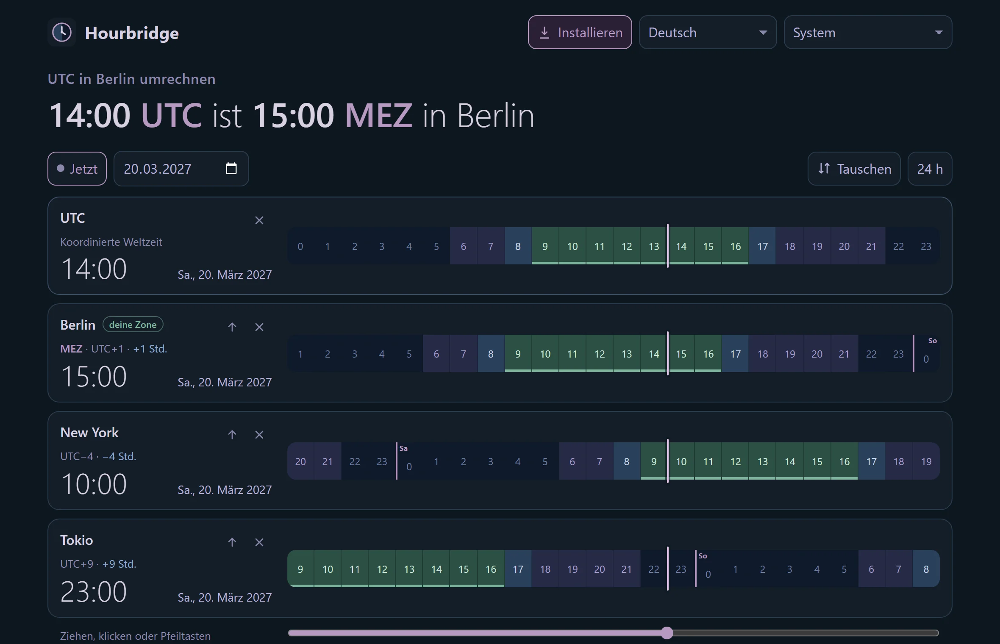

# Hourbridge

**UTC in deutsche Zeit umrechnen und zurück, ohne Werbung, Cookies oder Tracking.** Beliebig viele Orte, eine Zeitleiste zum Ziehen, bei der alle Uhren mitlaufen, und eine Warnung, wenn die Zeitumstellung den gewohnten Abstand durcheinanderbringt. Eine Datei, die in deinem Browser läuft und nach dem ersten Besuch auch offline funktioniert.

  

**Live:** https://dennismit2n.github.io/hourbridge/ · [English version](README.md)

## Was es kann

| | |
|---|---|
| **Antwort zuerst** | Oben steht der Satz, wegen dem du gekommen bist: „14:00 UTC ist 15:00 MEZ in Berlin“. Live auf die Sekunde oder für jede Zeit, die du wählst. |
| **Beliebig viele Orte** | Ein Suchfeld für Orte und Zeiten: „Tokio“, „9am New York“, „15 uhr tokio“ oder Kürzel wie PST und MEZ. „Meine Zeitzone“ fügt die Zone deines Geräts hinzu, ohne nach dem Standort zu fragen. |
| **Eine Zeitleiste** | Jeder Ort bekommt eine 24-Stunden-Leiste mit Nacht, Dämmerung, Tag und Arbeitszeit (9 bis 17 Uhr, unterstrichen). Ziehen, klicken oder Pfeiltasten, und alle Uhren laufen mit. Uhrzeiten lassen sich auch direkt in jede Karte tippen. |
| **Zeitumstellung richtig** | Die fehlende Stunde im März und die doppelte im Oktober werden erkannt und erklärt, mit Knopf für das zweite 02:30. Tage mit 23 oder 25 Stunden haben 23 oder 25 Felder. |
| **Kommende Umstellungen** | Die nächste Umstellung für jeden Ort und eine Warnung für die Wochen, in denen USA und Europa an verschiedenen Tagen umstellen (etwa 14. bis 28. März 2027: Berlin und New York liegen 5 statt 6 Stunden auseinander). |
| **Teilen** | Link kopieren, der genau diese Ansicht öffnet, Zeiten als Text kopieren oder eine Kalenderdatei (.ics) herunterladen. Dazu eine Tabelle mit allen Stunden des Tages. |

## Datenschutz

- Kein Konto, keine Werbung, keine Cookies, kein Tracking, keine Schriften oder Skripte von fremden Seiten.
- Die Seite trägt eine Content Security Policy mit `connect-src 'none'`: Der Browser selbst sperrt jede Anfrage, die die Seite schicken wollte. Das kannst du in den Entwicklertools nachsehen.
- Deine Orte stehen im Link (`#z=UTC,Europe/Berlin`), nicht auf deinem Gerät. Nur wenn du „Orte auf diesem Gerät merken“ anhakst, legt der Browser sie ab, und Abhaken löscht sie wieder. Sprache, 12/24 h und Darstellung werden nur gespeichert, wenn du sie änderst.
- Die Zeitzonenregeln kommen aus deinem Browser (die mitgelieferte IANA-Datenbank), es muss also nichts nachgeladen werden.

## Installieren und offline

Nach dem ersten Besuch hält ein Service Worker Hourbridge auch ohne Verbindung bereit. In Chrome, Edge und Samsung Internet erscheint oben ein Knopf „Installieren“, der es als App auf Handy oder Rechner einrichtet. Auf dem iPhone geht das in Safari über „Zum Home-Bildschirm“.

## Darstellung und Sprachen

Dunkel als Grundzustand, dazu Hell, zwei Modi mit hohem Kontrast, zwei für Farbenblinde und umgekehrte Farben, gemeinsam mit den anderen Werkzeugen der Werkstatt. Deutsch, Englisch, Spanisch, Französisch, Italienisch, Niederländisch, Polnisch, Portugiesisch, Türkisch, Russisch, Hindi, Chinesisch, Japanisch und Koreanisch. Einige Übersetzungen sind maschinell, Korrekturen nehme ich gern an.

## Entwicklung

Kein Bauschritt, keine Abhängigkeiten. Alles steht in `index.html`: die Stile, die Zeitzonenrechnung (Versatz über `Intl.DateTimeFormat`, Umstellungen per Wochensuche und Halbierung bis auf die Minute), die Übersetzungen und die Oberfläche. In `tools/` liegen die Skripte für Icons, Bildschirmfotos und Vorschaubild; sie nutzen Pillow und Playwright aus einem Nachbar-Repo und werden zum Betrieb nicht gebraucht.

## Lizenz

[MIT](LICENSE)

© 2026 Dennis_mit_2n · Teil der [Werkstatt](https://dennismit2n.github.io/)
