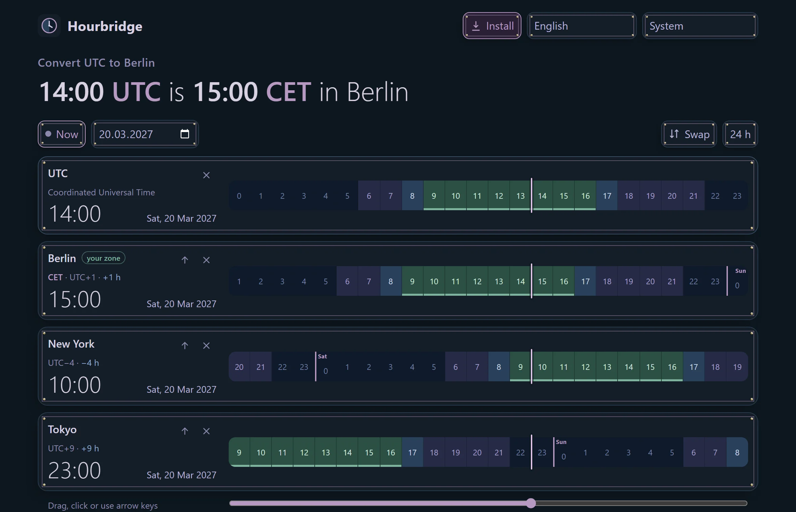

# Hourbridge

**Convert UTC to German time and back, without ads, cookies or tracking.** Add as many places as you like, drag one timeline and see every clock move, and get warned when daylight saving time makes the usual difference wrong. One file that runs in your browser and works offline after the first visit.

  

**Live:** https://dennismit2n.github.io/hourbridge/ · [Deutsche Fassung](README.de.md)

## What it does

| | |
|---|---|
| **The answer first** | A sentence at the top says what you came for: “14:00 UTC is 15:00 CET in Berlin”. Live to the second, or for any time you pick. |
| **Any number of places** | One search field for places and times: “Tokyo”, “9am New York”, “15 uhr tokio” or abbreviations like PST and CET. “My time zone” adds the zone of your device without asking for your location. |
| **One timeline** | Every place gets a 24-hour strip with night, dusk, day and working hours (9 to 5, underlined). Drag, click or use the arrow keys, and all clocks move together. You can also type a time straight into any card. |
| **Daylight saving done right** | The missing hour in March and the double hour in October are detected and explained, with a button for the second 02:30. Days with 23 or 25 hours have 23 or 25 cells. |
| **Clock changes ahead** | The next switch for every place, and a warning for the weeks when the US and Europe change on different days (for example 14 to 28 March 2027: Berlin and New York are 5 hours apart instead of 6). |
| **Share it** | Copy a link that opens exactly this view, copy the times as text, or download a calendar file (.ics). There is also a table with every hour of the day. |

## Privacy

- No account, no ads, no cookies, no tracking, no fonts or scripts from other sites.
- The page carries a Content Security Policy with `connect-src 'none'`: the browser itself blocks any request the page might try to send. You can check it in the developer tools.
- Your places live in the link (`#z=UTC,Europe/Berlin`), not on your device. Only if you tick “Remember places on this device” are they stored in your browser, and unticking deletes them again. Language, 12/24 h and appearance are stored only when you change them.
- Time zone rules come from your browser (the IANA database it ships with), so nothing has to be downloaded.

## Install and offline

After the first visit, a service worker keeps Hourbridge available without a connection. In Chrome, Edge and Samsung Internet an “Install” button appears at the top and sets it up as an app on your phone or computer. On an iPhone use “Add to Home Screen” in Safari.

## Appearance and languages

Dark by default, plus light, two high contrast modes, two colour-blind modes and inverted colours, shared with the other tools of the workshop. German, English, Spanish, French, Italian, Dutch, Polish, Portuguese, Turkish, Russian, Hindi, Chinese, Japanese and Korean. Some translations are machine-made, corrections are very welcome.

## Development

No build step and no dependencies. Everything lives in `index.html`: the styles, the time zone maths (offsets via `Intl.DateTimeFormat`, clock changes found by a weekly search and a binary search to the minute), the translations and the interface. `tools/` holds the scripts for the icons, screenshots and the preview image; they use Pillow and Playwright from a neighbouring repository and are not needed to run the app.

## Licence

[MIT](LICENSE)

© 2026 Dennis_mit_2n · part of [the workshop](https://dennismit2n.github.io/)
